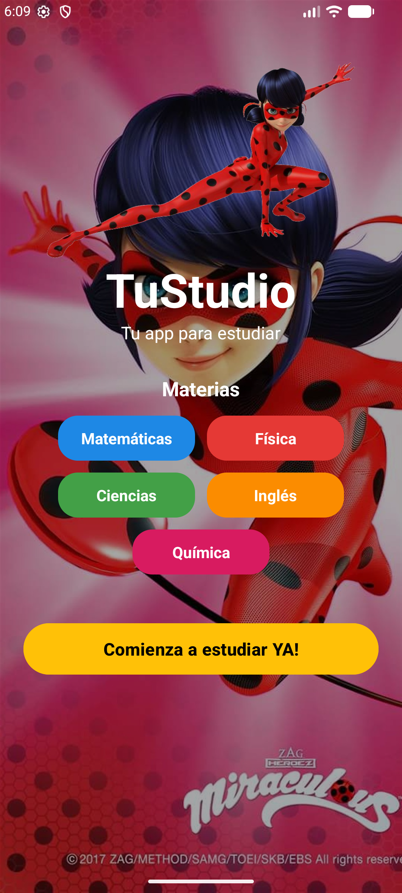
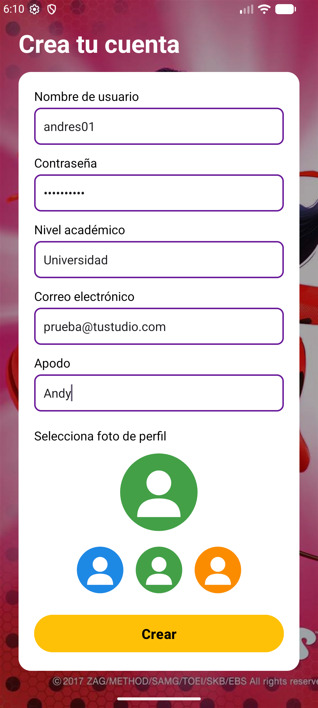
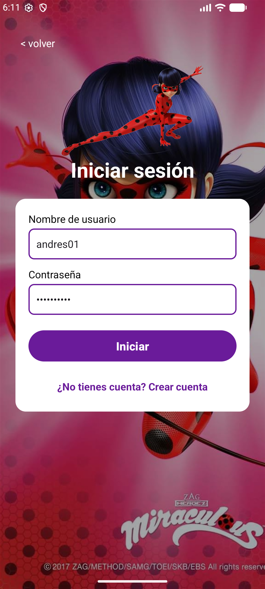

# TuStudio

**TuStudio** es una app Android para estudiantes, hecha en Kotlin, que permite crear una cuenta, iniciar sesión y ver un perfil personalizado. Los usuarios se guardan en una base de datos local SQLite dentro del teléfono.

Proyecto EP2 de Andrés Popoca, José Arenal y Karla Poluceno.

<p align="center">
  
  
  
  
</p>

## Pantallas

| Pantalla | Qué hace |
|---|---|
| **Inicio** (`MainActivity`) | Muestra el nombre de la app, la mascota, las materias (Matemáticas, Física, Ciencias, Inglés y Química) y el botón **"Comienza a estudiar YA!"**, que abre el inicio de sesión. |
| **Iniciar sesión** (`LoginActivity`) | Pide usuario y contraseña y los compara con la base de datos. Si son correctos muestra "Bienvenido" y abre el perfil; si no, avisa "Usuario o contraseña incorrectos". Tiene un enlace para crear una cuenta. |
| **Crea tu cuenta** (`RegistroActivity`) | Pide usuario, contraseña, nivel académico, correo y apodo, y permite elegir una de tres fotos de perfil. Revisa que no haya campos vacíos y que el usuario no exista antes de guardarlo. |
| **Perfil** (`PerfilActivity`) | Muestra el apodo, la foto elegida, el nombre de usuario, el nivel académico y el correo. Tiene el botón **"Empezar a estudiar"** y la opción para cerrar sesión. |

## Base de datos

La clase `BaseDatos` (`SQLiteOpenHelper`) crea la base `tustudio.db` con la tabla `usuarios`:

| Campo | Tipo | Descripción |
|---|---|---|
| `id` | INTEGER | Identificador, se genera solo |
| `usuario` | TEXT | Nombre de usuario, único |
| `contrasena` | TEXT | Contraseña |
| `nivel` | TEXT | Nivel académico |
| `correo` | TEXT | Correo electrónico |
| `apodo` | TEXT | Nombre que se muestra en el perfil |
| `foto` | INTEGER | Foto de perfil elegida (1, 2 o 3) |

Funciones principales: `registrar`, `existeUsuario`, `iniciarSesion` y `buscarUsuario`.

## Tecnologías

- Kotlin y vistas XML (AppCompat, Material Components, ConstraintLayout)
- SQLite con `SQLiteOpenHelper`
- Android Gradle Plugin 9.4.1, Java 11
- `minSdk` 24 (Android 7.0), `targetSdk` 37

## Estructura del proyecto

```
app/src/main/
├── java/com/example/ep2_popocaandres_arenaljose_polucenokarla/
│   ├── MainActivity.kt       # Pantalla de inicio
│   ├── LoginActivity.kt      # Iniciar sesión
│   ├── RegistroActivity.kt   # Crear cuenta
│   ├── PerfilActivity.kt     # Perfil del usuario
│   └── BaseDatos.kt          # Base de datos SQLite
└── res/                      # Layouts, colores, avatares e imágenes
Evidencia/
├── descripciones.md          # Descripción del diseño, la base de datos y las pruebas
└── capturas/                 # Capturas de las pruebas de registro e inicio de sesión
```
